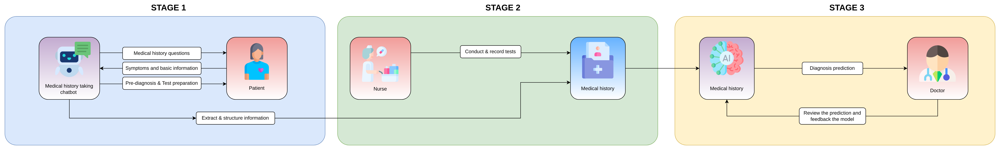

<div align="center">

# Privacy-Preserving Multi-Agent Intelligent Chatbot for PCOS Diagnosis

[**Huyen-Trang Le**](https://orcid.org/0009-0004-3738-0235)<sup>1\*</sup> ·
[**Thanh-Nam Tran**](https://orcid.org/0009-0007-3571-6075)<sup>2\*</sup> ·
**Aakash Soni**<sup>3</sup> ·
[**Samia Bouzefrane**](https://orcid.org/0000-0002-0979-1289)<sup>4</sup>

<sup>1</sup>IBISC Laboratory, Université d’Évry Paris-Saclay &nbsp;
<sup>2</sup>Télécom Paris, Institut Polytechnique de Paris<br>
<sup>3</sup>LyRIDS Laboratory, ECE Paris &nbsp;
<sup>4</sup>CEDRIC Laboratory, Cnam Paris

<sup>\*</sup>Equal contribution

[](https://innovher-competition.github.io/demo/)
[](#)
[](docs/presentation/main.pdf)
[](#)
[](#)

</div>

---

This repository hosts the **official project page** for our paper: the article summary, the system architecture, the video presentation, and the interactive demo.

## Overview

Polycystic ovary syndrome (PCOS) affects an estimated **10–13%** of women of reproductive age, yet **up to 70%** of them do not know they have it. Diagnosis is often slow: one-third of women wait more than two years, and almost half consult three or more health professionals before being diagnosed. The medical history PCOS diagnosis depends on is intimate (menstrual, sexual, reproductive), and many patients are reluctant to share it because of stigma, embarrassment, or fear of data misuse.

We propose a **privacy-preserving, multi-agent intelligent chatbot** for early PCOS screening and education. It:

- **coordinates specialised agents** for patient screening, workflow automation, and personalised lifestyle recommendations in a single interface;
- **grounds its answers** in trusted medical sources through retrieval-augmented generation (RAG);
- **explains its decisions** with explainable AI (XAI), with every output traceable to a specific model version for accountability;
- **protects sensitive health data** with privacy-enhancing techniques and secure access control, in line with the transparency and oversight requirements of the GDPR, HIPAA, and the EU AI Act.

## Architecture

<p align="center"></p>

1. **Medical history taking.** The chatbot interviews the patient, gives a pre-diagnosis and test preparation, and structures the answers into a medical history.
2. **Clinical testing.** A nurse conducts and records the tests in the same medical history.
3. **Diagnosis support.** An AI model predicts a diagnosis from the medical history. The doctor reviews the prediction, and that feedback improves the model.

## Presentation

The slides are in [`docs/presentation/`](./docs/presentation/) ([PDF](./docs/presentation/main.pdf)), built from the DEE@ISEP Beamer template. To rebuild the PDF after editing `main.tex`, use [Tectonic](https://tectonic-typesetting.github.io/) (no TeX installation needed) or any LaTeX distribution:

```bash
cd docs/presentation
tectonic main.tex        # or: latexmk -pdf main.tex
```

## Running the project page locally

The page is built with [Astro](https://astro.build/), [MDX](https://mdxjs.com/), and [Tailwind](https://tailwindcss.com/). It requires [Node.js](https://nodejs.org/) **24+** and [pnpm](https://pnpm.io/) **11+**.

```bash
git clone https://github.com/InnovHer-Competition/demo.git
cd demo
pnpm install
pnpm run dev        # live preview at http://localhost:4321
```

To produce a static build in `./dist/`:

```bash
pnpm run build
```

### Deployment

Every push to `main` builds the site and deploys it to GitHub Pages through [`.github/workflows/astro.yml`](./.github/workflows/astro.yml).
One-time setup in **Settings → Pages**, set **Source** to **GitHub Actions**. The page is then served at <https://innovher-competition.github.io/demo/>.

## Citation

If you find this work useful, please cite:

```bibtex
@misc{le2026pcoschatbot,
  author = {Le Huyen-Trang, Tran Thanh-Nam, Soni Aakash and Bouzefrane Samia},
  title  = {Privacy-Preserving Multi-Agent Intelligent Chatbot for {PCOS} Diagnosis},
  year   = {2026},
  note   = {Manuscript in preparation}
}
```

## Contact

For questions about the paper, contact [huyen.le@etud.univ-evry.fr](mailto:huyen.le@etud.univ-evry.fr) or [thanhnamtran1605@gmail.com](mailto:thanhnamtran1605@gmail.com), or open an issue.

## Acknowledgements

The project page is built on Roman Hauksson-Neill's [Academic Project Page Template](https://github.com/RomanHauksson/academic-project-astro-template). That template is adapted from Eliahu Horwitz's [Academic Project Page Template](https://github.com/eliahuhorwitz/Academic-project-page-template) and Keunhong Park's [Nerfies page](https://nerfies.github.io/), and is licensed under [CC BY-SA 4.0](http://creativecommons.org/licenses/by-sa/4.0/).
